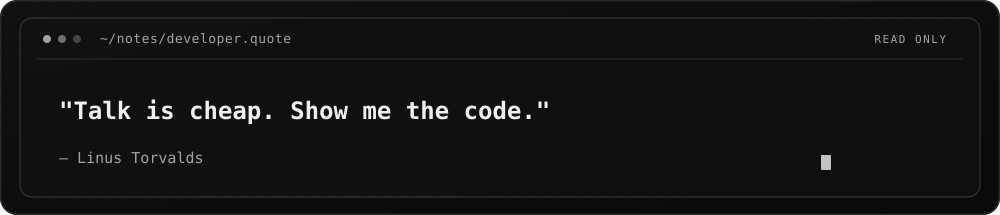

<picture>
  <source media="(prefers-color-scheme: dark)" srcset="./dark.svg">
  <source media="(prefers-color-scheme: light)" srcset="./light.svg">
  
</picture>

## About Me

- I'm a **2nd-year Digital Development student at OFPPT** and a former **1337 (42 Network) student**.
- I have a strong foundation in **C (intermediate to advanced)** and some experience with **C++**.
- I'm learning and working with **HTML, CSS, JavaScript, PHP, Python, SQL, and MySQL**, and I've recently started exploring **React**.
- I'm still learning, improving my skills, and building projects to gain experience.
- I'm interested in **game development**, and I'd like to make my own games one day.

## Connect

## Tech Stack

            

**Currently exploring:** React and game development.

## GitHub Activity

<!-- Monochrome, live public-data badges. These are not commit or streak estimates. -->

  
  
  

## Developer Quote

<picture>
  <source media="(prefers-color-scheme: dark)" srcset="./quote-dark.svg">
  <source media="(prefers-color-scheme: light)" srcset="./quote-light.svg">
  
</picture>

## Support

