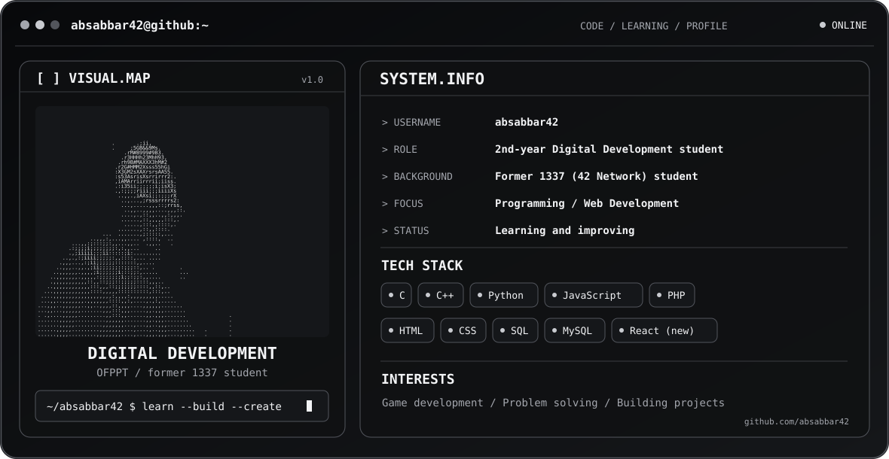

<picture>
  <source media="(prefers-color-scheme: dark)" srcset="./dark.svg">
  <source media="(prefers-color-scheme: light)" srcset="./light.svg">
  
</picture>

# About Me

- I'm a **2nd-year Digital Development student at OFPPT** and a former **1337 (42 Network) student**.
- I have a solid foundation in **C (intermediate to advanced)** and some experience with **C++**.
- I'm learning and working with **HTML, CSS, JavaScript, PHP, Python, SQL, and MySQL**, and I've recently started exploring **React**.
- I'm still learning, improving my skills, exploring new technologies, and building projects to gain experience.
- I'm passionate about gaming and interested in **game development**, with the goal of creating my own games someday.
- My goal is to keep growing as a developer, improve my problem-solving skills, and turn my ideas into real projects.

## Socials

## Tech Stack

            

**Currently learning:** React and game development.

## GitHub Activity

[View my contribution activity](https://github.com/absabbar42?tab=overview)

### Languages & Tools

C · C++ · Python · HTML · CSS · JavaScript · PHP · SQL · MySQL · React (learning)

> GitHub's repository language statistics reflect code in public repositories, not overall proficiency. I've left out third-party stats and streak images that were showing incorrect totals or failing to load.

## Developer Quote

[View a random developer quote](https://quotes-github-readme.vercel.app/api?type=horizontal&theme=dark)

## Profile Views

## Support

